Name: Muhammad Ebadullah

I fine-tuned Llama 3.2 3B Instruct on clinical Q&A pairs using 4-bit quantization (QLoRA) with Unsloth. Everything ran on a free Colab T4 GPU. The notebook in this folder is the one I ran and it still has all the outputs.

Notebook: [Medical_QLoRA_Unsloth.ipynb](Medical_QLoRA_Unsloth.ipynb)

## Setup used
| Item | Value |
|---|---|
| Base model | `unsloth/Llama-3.2-3B-Instruct`, loaded in 4-bit |
| Dataset | `medalpaca/medical_meadow_medical_flashcards` (33,955 Q&A pairs, 5,000 used) |
| Method | QLoRA (4-bit NF4 base weights + LoRA adapters) |
| LoRA | r = 16, alpha = 16, on q/k/v/o and gate/up/down projections |
| Training | 1 epoch, 625 steps, batch size 2 x 4 gradient accumulation, learning rate 2e-4, 8-bit AdamW |
| Loss | Computed on the assistant answers only (`train_on_responses_only`) |
| GPU | Colab Tesla T4 (14.56 GB) |

## Steps in the notebook
1. Check the GPU and install Unsloth
2. Load the model in 4-bit
3. Ask four medical questions to the base model (saved for comparison)
4. Load the dataset and take 5,000 random samples
5. Format every pair with the Llama 3 chat template (this is the tokenization step)
6. Add LoRA adapters
7. Train with `SFTTrainer`, while tracking time and GPU memory
8. Save the adapter (`medical_llama_lora`)
9. Test the fine-tuned model on seven medical questions
10. Reload the saved adapter and test again

## Results
| Metric | Value |
|---|---|
| Trainable parameters | 24,313,856 of 3,237,063,680 (0.75%) |
| Training time | 1,227 sec (about 20.5 min), 4.07 samples/sec |
| Loss | 1.044 at step 10, 0.683 at step 620 (average 0.7479) |
| GPU memory after loading the model | 2.22 GB |
| Peak GPU memory in training | 3.656 GB (25.1% of 14.563 GB) |
| Extra memory used by LoRA training | 1.23 GB |
| Saved adapter size | about 93 MB |

What I saw: the loss dropped fast in the first 170 steps and then stayed around 0.68 to 0.78. Before fine-tuning, the base model gave long answers with numbered lists that were cut off at the token limit. After fine-tuning, the answers are short and direct, like the flashcards in the dataset.

## Outputs from my run
**GPU check**

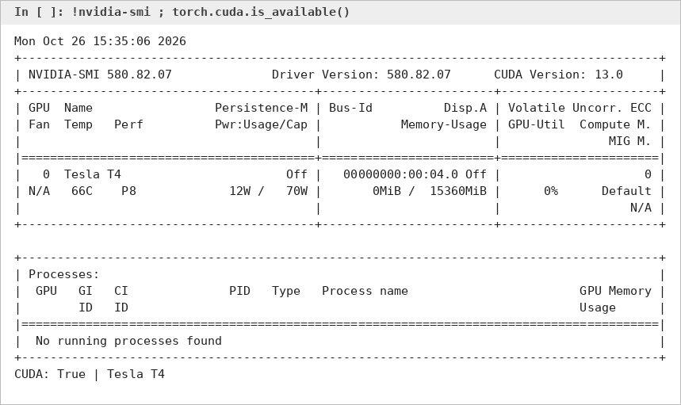

**Model loaded in 4-bit (memory after loading)**

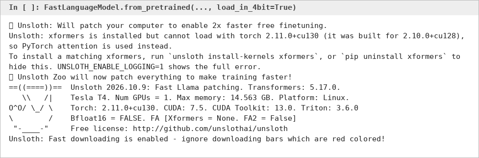

**Base model answers before fine-tuning (first 2 of 4 questions)**

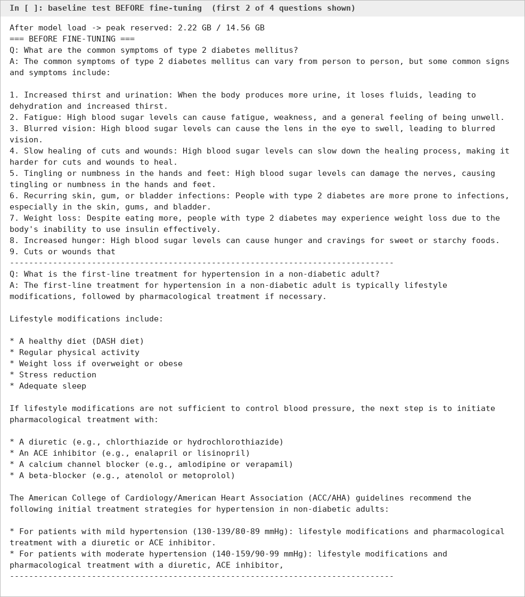

**Dataset**

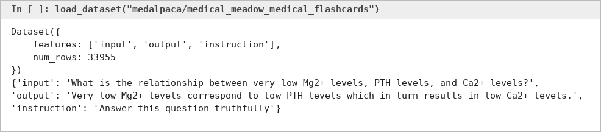

**Trainable parameters after adding LoRA**

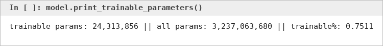

**Training logs**

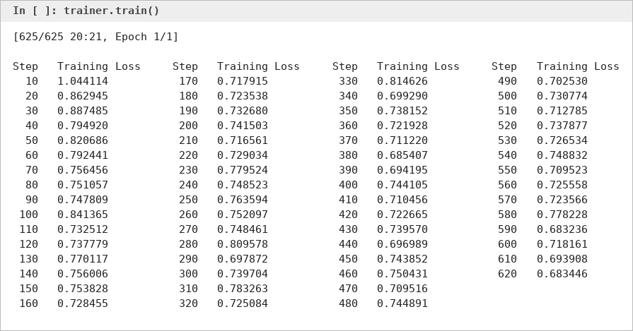

**Training time and memory**

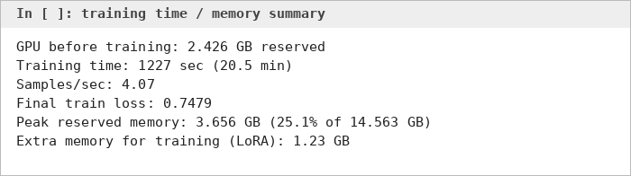

**Loss curve**

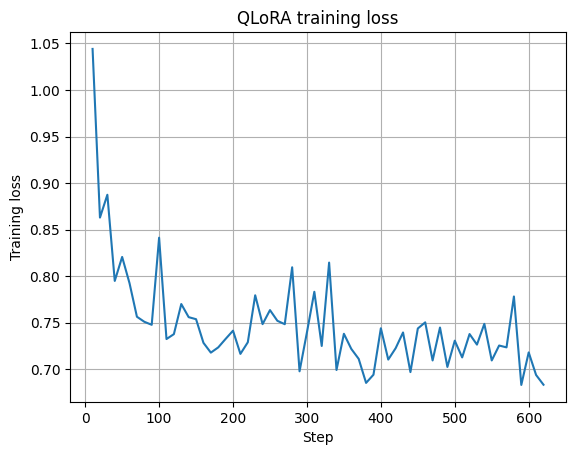

**Adapter saved**

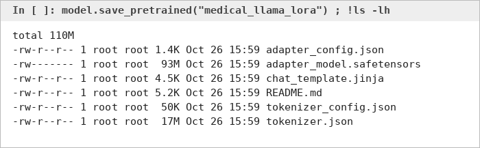

**Answers after fine-tuning**

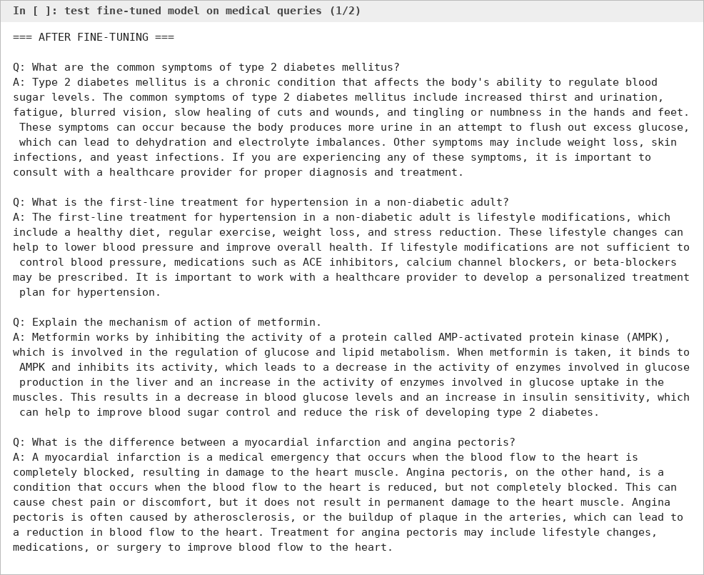

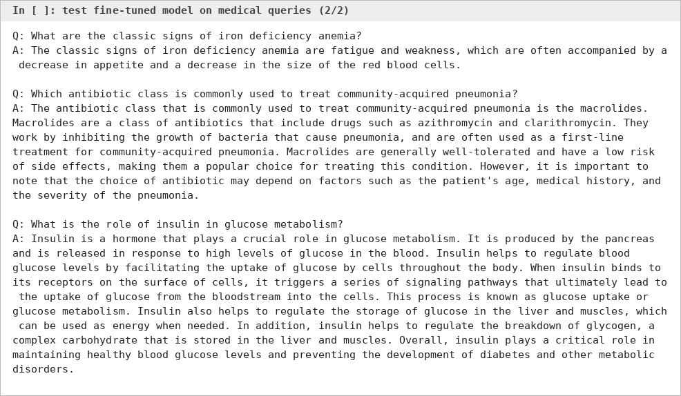

**Saved adapter reloaded and tested**

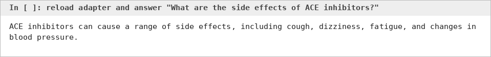

The images above are captures of the output text from the notebook run. The full outputs are in the notebook itself.

## How to run it yourself
1. Open the notebook in Google Colab (File > Upload notebook, or open from GitHub).
2. Runtime > Change runtime type > T4 GPU.
3. Run all cells. It takes about 20 to 40 minutes on the free tier.

To use a different base model such as DeepSeek-R1, change the `model_name` in the model loading cell (for example `unsloth/DeepSeek-R1-Distill-Llama-8B`).

## About the adapter
The adapter folder is about 93 MB, so it is not stored in this repository.

## Limitations
- Only 5,000 samples and 1 epoch, because of the free Colab limits.
- The model learned the short flashcard style more than it learned facts. Some answers are wrong. For example, the metformin answer says metformin inhibits AMPK, but it actually activates AMPK. The iron deficiency answer is also very short.
- I only compared answers by reading them. I did not run a medical benchmark.
- This is a learning project. It must not be used for real medical advice.
